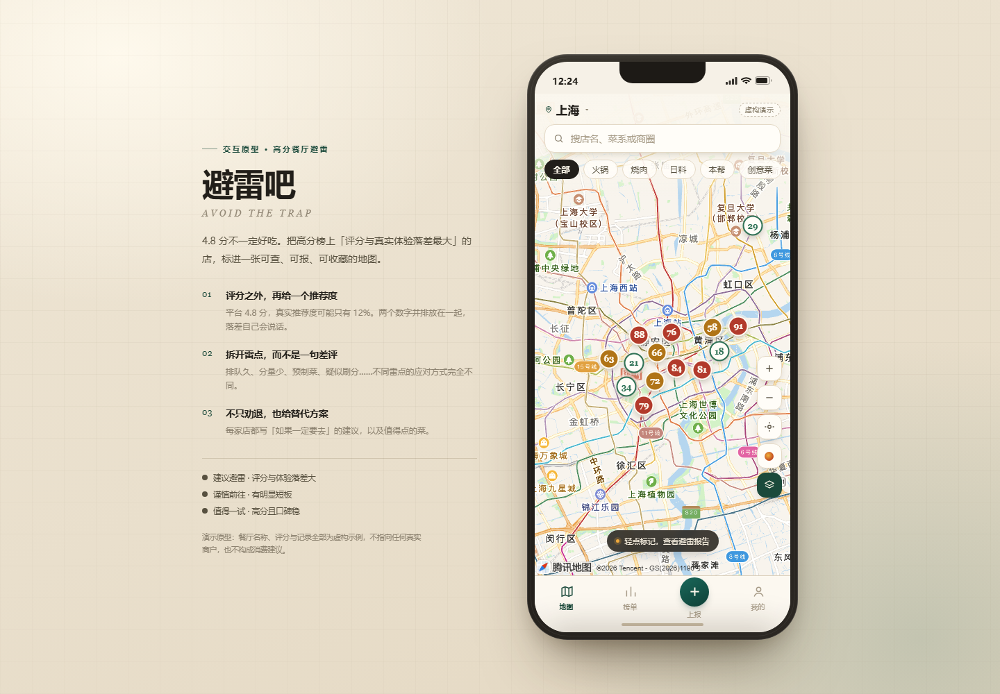

# 避雷吧 · 高分餐厅避雷地图

把「平台评分」和「真实推荐度」并排放进一张地图。哪家店分数高得可疑，一眼就能看出来。



> 平台评分 4.8，真实推荐度 12%。两个数字并排放，落差自己会说话。

**在线体验：** <https://peppa7765.github.io/restaurant-radar/>

---

## 这是什么

一个纯前端的**产品原型**：用 14 家虚构餐厅的数据，演示「高分店避雷」这件事可以怎么被产品化。

它不是点评网站的第 N 个复制品。它不生产更多评价，而是把两个已有数字之间的矛盾摊开——平台评分是给店家看的，真实推荐度是给下一个想进门的人看的。

## 为什么做这个

去一家 4.8 分的店，排一小时队，吃到一份预制菜。回来翻评论，发现差评都在第二页。

问题从来不是信息不够，而是信息的**排布方式**故意让人看不见落差。所以这个原型只做三件事：

1. 把落差做成主指标，而不是把差评埋进折叠区
2. 把「雷点」结构化——排队久、分量少、预制菜、价格虚高、疑似刷分——而不是一句「不好吃」
3. 让每条记录都带日期，过期的差评自动降权

## 核心机制

三个数字互相咬合：

| 指标 | 算法 | 说明 |
|---|---|---|
| **避雷指数** | `clamp(基础热度 + 用户记录加权, 8, 99)` | 用户新增记录按 `(5 − 星级) × 3 + 雷点数 × 1.6` 追加 |
| **真实推荐度** | `100 − 避雷指数` | 越高越值得去 |
| **落差** | `round(平台评分 × 20 − 真实推荐度)` | 榜单默认按它倒序 |

判定阈值：

| 避雷指数 | 结论 | 标记 |
|---|---|---|
| ≥ 75 | 建议避雷 | 雷 |
| 55–74 | 谨慎前往 | 慎 |
| < 55 | 值得一试 | 荐 |

14 家虚构餐厅的避雷指数分布在 **18–91** 之间，刚好把三档全部覆盖。

## 功能

**地图**
- 腾讯地图 GL 真实底图（可选，见下方「关于腾讯地图 Key」）；加载失败或离线时自动回退到内置示意底图，不会白屏
- 标记按避雷指数着色；像素级避让，密集区域不重叠
- 拖拽、滚轮、双指缩放、双击放大、一键回到市中心

**榜单**
- 三种排序：落差最大 / 避雷指数 / 评分最高
- 每家店展示平台评分、人均、商圈、前三个雷点、真实推荐度

**详情**
- 平台评分 → 真实推荐度的对照卡，加避雷指数条（附同菜系平均值）
- 雷点分布条形图、一句话总结、推荐菜 / 避雷菜
- 「如果一定要去」的替代方案——把「别去」变成「怎么去」
- 收藏进避雷清单、我也踩过雷、纠错入口

**上报**
- 店名、菜系、商圈、平台评分、星级、雷点多选、人均、排队时长、一句话描述、匿名开关
- 提交后即时重算避雷指数与推荐度，同步刷新地图和榜单

**我的**
- 避雷清单、我的记录、帮到人次数
- 榜单规则说明（指数怎么算、怎么读、不收录什么）、数据与隐私说明

支持深链直接定位：`#rank`、`#report`、`#me`、`#place=r01`

## 本地运行

无需构建、无外部依赖、无后端：

```bash
# 起一个静态服务（推荐，避免 file:// 的本地存储限制）
python -m http.server 8765
# 打开 http://127.0.0.1:8765
```

也可以直接双击 `index.html`。

### 关于腾讯地图 Key

**仓库里不含任何 Key。** `config.js` 默认关闭真实底图，开箱即用，直接显示内置的示意底图。

想开真实底图：把 `config.local.example.js` 复制为 `config.local.js`，填入自己在[腾讯位置服务](https://lbs.qq.com/)申请的 Web 端（JS API）Key。`config.local.js` 已写入 `.gitignore`，不会被提交。

申请后请在控制台配置「安全域名」白名单（`127.0.0.1`、`localhost`、自己的部署域名），并且只勾选 Web 端 JS API 权限。

## 技术说明

- **零依赖**：没有框架、没有构建步骤、没有 `node_modules`。`index.html` 加 5 个文件就能跑。
- **状态**：全部存在 `localStorage`（键名 `avoid-radar.v1`），刷新不丢，清浏览器数据即重置。
- **首次打开**会放入 3 个示例收藏和 2 条示例记录，避免「我的」页空白。
- **降级策略**：地图加载失败、超时或容器尺寸异常时保留示意底图，并在顶部给一条可关闭的提示，不会白屏。

## 项目结构

```
restaurant-radar/
├── index.html              # 页面骨架 + 手机外壳 + 示意地图 SVG
├── styles.css              # 全部样式（无框架）
├── config.js               # 公开配置：中心点、缩放、底图开关
├── config.local.example.js # 本地 Key 配置模板
├── data.js                 # 虚构餐厅数据、雷点标签、榜单规则文案
├── app.js                  # 状态、指标计算、地图交互、弹层、上报落地
├── preview-map.png         # 截图：地图与榜单
└── preview-detail.png      # 截图：详情页
```

## 数据与合规

- **所有餐厅名称、地址、评分、记录均为虚构示例**，不指向任何真实商户，也不构成消费建议。
- 内容底线：只收具体经历，双人复核，可申诉，可下架公示。
- 只收公共场所，不收民宅与员工厕所这类隐私信息；定位仅用于距离计算。
- 正式版还需要：上报审核、商家申诉、限流与反刷、POI 检索，以及「评分来源」标注。

## 已知限制

- 数据全部虚构，没有接 POI 检索；正式版需要真实数据源与评分来源标注
- 没有后端与账号体系，收藏和记录只存在本地浏览器
- 真实底图需要自己的腾讯地图 Key
- 目前是 Web 原型；转微信小程序需要把视图层改写为 WXML/WXSS，交互逻辑可复用

## 关于制作方式

这个原型由我和 AI 协作完成：产品定位、交互取舍和内容尺度由我判断，代码与文案由 AI 辅助生成，再逐轮实测修正。

放在这里是因为我相信——**「能不能把一个想法做成别人点得开的东西」**，比「能不能手写每一行代码」更能说明产品能力。它仍然是原型：数据虚构、没有后端、没有账号体系，这些限制我在上面全部写清楚了，而不是藏起来。

## License

[MIT](LICENSE)
